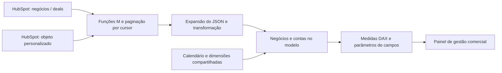

# Gestão Comercial — Pipeline de Vendas e Receita

Case de Business Intelligence para acompanhar oportunidades, evolução comercial, contratos, faturamento e pagamentos com Power BI e HubSpot.

**Power BI · DAX · Power Query / M · HubSpot CRM · API REST · Modelagem de dados**

## O problema

O time de vendas precisava acompanhar cada negócio: sua evolução entre etapas, valores envolvidos, atividades pendentes, perdas e fechamento. A liderança comercial e financeira precisava observar o pipeline e os resultados em diferentes períodos.

Enquanto uma visão de marketing acompanha contatos e qualificação de leads, esta solução concentra a análise nos **negócios e seus desdobramentos comerciais e financeiros**.

## O que a solução apresenta

| Frente | Perguntas de negócio |
| --- | --- |
| Oportunidades | Quantos negócios foram gerados e quantos diagnósticos ocorreram? |
| Negociação | Como evoluíram propostas, aceites e contratos? |
| Receita | Quais valores foram assinados, faturados e pagos? |
| Conversão | Qual a relação entre diagnósticos realizados e contratos assinados? |
| Ciclo e acompanhamento | Quais negócios estão parados e há quanto tempo? |
| Perdas | Quais motivos e etapas concentram perdas? |
| Evolução temporal | Como os indicadores variam por mês, trimestre e ano? |

O relatório permite alternar indicadores de oportunidade, negociação e contratos, além da granularidade temporal. No inventário foram identificadas **14 páginas, 210 medidas DAX e 24 relacionamentos**, incluindo **13 relações inativas** e **10 com filtro bidirecional**.

## Arquitetura em uma visão



Negócios e contas são frentes analíticas distintas. O inventário de relações **não apresenta uma ligação direta entre essas tabelas**; a documentação mostra os vínculos efetivamente encontrados.

## Explore o case

- [Contexto, entregas e escopo](docs/projeto.md)
- [Modelo e comportamento dos relacionamentos](docs/modelo-relacionamentos.md)
- [Inventário dos 24 relacionamentos](docs/inventario-relacionamentos.md)
- [Integração HubSpot: funções, loop e aplicação](docs/integracao-hubspot.md)
- [Indicadores e medidas DAX selecionadas](docs/indicadores-dax.md)
- [Catálogo de 33 medidas: vendas, faturamento e acompanhamento](docs/catalogo-medidas.md)
- [Seletores de indicadores e períodos](docs/interatividade.md)
- [Capturas do painel](assets/screenshots/README.md)

## Exemplo: conversão de diagnósticos em contratos

```dax
TX.CV | Realizado x Assinado =
DIVIDE(
    [Qtd | Contratos Assinados],
    [Qtd | Diagnósticos Realizados],
    0
)
```

A medida compara os totais no contexto de filtros. Como as etapas usam datas diferentes, essa razão por período não deve ser interpretada automaticamente como conversão de uma mesma coorte de negócios.

## Indicadores além do funil

A seleção pública foi ampliada para **33 medidas**, organizadas em seis grupos:

| Grupo | Exemplos |
| --- | --- |
| Volume comercial | Diagnósticos, propostas, contratos assinados e pagos |
| Valores e receita | Valores propostos, assinados, faturados e associados a negócios pagos |
| Ticket médio | Propostas, negociação, assinatura, faturamento e pagamento |
| Conversão | Diagnóstico para negociação e assinatura |
| Carteira e acompanhamento | Contas em etapa de novos clientes e negócios sem atividade |
| Período e perdas | Quantidade e valor perdidos, valores por etapa e negócios na mesa |

O [guia de indicadores](docs/indicadores-dax.md) explica as diferenças entre assinatura, faturamento e pagamento. O [catálogo](docs/catalogo-medidas.md) descreve cada expressão, inclusive quando o nome histórico não representa exatamente o cálculo.

## Integração com HubSpot

O projeto usa a API CRM v3 para negócios e para um objeto personalizado. A extração foi organizada com funções de obtenção dos dados e funções de próxima página, aplicadas a uma lista de cursores com `List.Generate`.

O portfólio inclui uma [reconstrução didática parametrizada](power-query/README.md) desse padrão. O endereço público da API foi mantido, enquanto autenticação, identificadores e propriedades internas foram retirados.

## Telas

Capturas do painel desenvolvido, disponibilizadas para apresentar a experiência visual do projeto.


## Participação e contexto

Desenvolvi o painel para a gestão comercial, com integração ao HubSpot como parte da solução. A documentação técnica desta versão foi baseada nos arquivos PBIP do projeto. Não atribuo ganhos de receita ou produtividade sem evidência específica.

## Escopo público

Este é um portfólio documental, com diagramas e exemplos selecionados. PBIX, PBIP completo, todas as medidas, mapeamentos integrais, dados reais e credenciais permanecem reservados.

A conferência foi feita nos arquivos de definição e no briefing. Não foram executados atualização, conexão ao CRM ou testes dos cálculos no Power BI Desktop. O indicador de ciclo negativo visto na referência continua pendente de validação e não é apresentado como resultado validado.

## Histórico

Consulte o [histórico de alterações](CHANGELOG.md). O código é disponibilizado para consulta técnica; esta edição não concede licença de reutilização.
