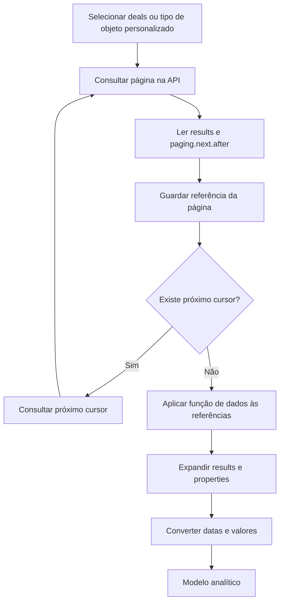

# HubSpot: negócios, objeto personalizado e paginação

## Fontes confirmadas no código

| Frente | Evidência observada | Uso analítico |
| --- | --- | --- |
| Negócios | Requisições a crm/v3/objects/deals | Oportunidades e etapas comerciais |
| Objeto personalizado | Requisições a crm/v3/objects com tipo de objeto parametrizado | Tabela hs_Contas e análises de contas/faturamento |
| Metadados | Consultas de propriedades e pipeline/estágios | Filtros e interpretação de valores |
| Apoio | Definições de colaboradores, reuniões, atividades e histórico | Contexto adicional; vínculo direto depende das relações ou consultas |

**Deals e negócios são a mesma entidade neste contexto.** Um objeto personalizado é outra estrutura definida no CRM; não se deve confundi-lo com um objeto padrão apenas pelo nome da tabela no Power BI.

A API mantém documentação para [negócios](https://developers.hubspot.com/docs/api-reference/legacy/crm/objects/deals/guide) e [objetos personalizados](https://developers.hubspot.com/docs/api-reference/legacy/crm/objects/custom-objects/guide). A documentação atual classifica essas rotas na seção legacy; esta edição registra o caminho utilizado pelo projeto, sem prometer compatibilidade futura ou acesso ao ambiente original.

## Fluxo da extração



O diagrama descreve a abordagem de descobrir referências e depois obter os dados. Não representa uma chamada única por página.

## Como era organizado

No código de negócios foram encontradas getPropriedades_Negócios, para obtenção de results, e fxnextPage_Negócios, para leitura do próximo after. A consulta principal gera a lista de cursores e invoca a função de dados por linha.

Na frente de objeto personalizado, fx_Dados retorna uma tabela com id, properties e data de criação; fx_Next_Page obtém a continuação. A consulta hs_Contas aplica a função à lista de páginas e expande o resultado.

Assim, a separação entre **função de próxima página**, **função de dados** e **consulta que aplica as funções** aparece nas duas frentes.

## Exemplo público adaptado

### 1. Função de dados

fxDadosObjeto recebe o tipo de objeto e o cursor. Mantém a base pública do HubSpot, usa RelativePath e Query, e devolve o JSON interpretado como registro M.

```powerquery
// Exemplo adaptado do padrão encontrado no projeto.
// pTokenHubSpot é um parâmetro de texto reservado, sem valor distribuído.
// O armazenamento seguro da credencial deve ser definido no ambiente real.
(TipoObjeto as text, After as nullable text) as record =>
let
    ParametrosBase = [
        limit = "100",
        archived = "false"
    ],
    Parametros =
        if After = null or After = "" then
            ParametrosBase
        else
            Record.AddField(ParametrosBase, "after", After),
    Resposta = Json.Document(
        Web.Contents(
            "https://api.hubapi.com",
            [
                RelativePath = "crm/v3/objects/" & TipoObjeto,
                Query = Parametros,
                Headers = [Authorization = "Bearer " & pTokenHubSpot]
            ]
        )
    )
in
    Resposta
```

Arquivo: [fxDadosObjeto.m](../power-query/fxDadosObjeto.m). O token não é distribuído; a referência ilustra autenticação, sem recomendar armazenamento de segredos em arquivos versionados.

### 2. Função de paginação

O cursor é uma referência de continuação fornecida pela API. Não deve ser incrementado como um número de página. No padrão CRM v3, o projeto lê paging.next.after.

```powerquery
// Retorna o cursor da próxima página. null encerra o loop.
// A chamada à API fica centralizada em fxDadosObjeto.
(TipoObjeto as text, After as nullable text) as nullable text =>
let
    Resposta = fxDadosObjeto(TipoObjeto, After),
    Paging = Record.FieldOrDefault(Resposta, "paging", null),
    Next = if Paging = null then null else Record.FieldOrDefault(Paging, "next", null),
    Cursor = if Next = null then null else Record.FieldOrDefault(Next, "after", null)
in
    if Cursor = null then null else Text.From(Cursor)
```

Arquivo: [fxProximaPagina.m](../power-query/fxProximaPagina.m). A ausência do próximo cursor encerra o percurso; falhas HTTP não são transformadas silenciosamente em fim da paginação neste exemplo.

### 3. List.Generate e função aplicada

```powerquery
// Consulta adaptada para deals. Depende das duas funções e da autenticação.
// Para objeto personalizado, o tipo deve ser um parâmetro reservado validado no ambiente.
let
    TipoObjeto = "deals",
    Cursores = List.Generate(
        () => "",
        each _ <> null,
        each fxProximaPagina(TipoObjeto, _)
    ),
    TabelaCursores = Table.FromList(
        Cursores,
        Splitter.SplitByNothing(),
        {"After"}
    ),
    FuncaoAplicada = Table.AddColumn(
        TabelaCursores,
        "Resposta",
        each fxDadosObjeto(TipoObjeto, [After]),
        type record
    ),
    ListasResultados = List.Transform(
        FuncaoAplicada[Resposta],
        each Record.Field(_, "results")
    ),
    Registros = List.Combine(ListasResultados),
    Tabela = Table.FromRecords(
        Registros,
        {"id", "properties"},
        MissingField.UseNull
    )
in
    Tabela
```

Arquivo: [Negocios.m](../power-query/Negocios.m).

| Etapa | O que faz |
| --- | --- |
| TipoObjeto | Define a entidade solicitada |
| Cursores | Gera as referências de continuação até null |
| TabelaCursores | Cria uma linha para cada referência |
| FuncaoAplicada | Consulta os dados para a referência daquela linha |
| ListasResultados | Obtém results de cada resposta |
| Registros | Combina as listas |
| Tabela | Organiza id e properties, mantendo as propriedades em registro |

A aplicação é o equivalente em M de adicionar uma coluna invocando uma função personalizada. A expansão das propriedades de negócio foi reservada.

### 4. Uso para objeto personalizado

O mesmo exemplo aceita um tipo de objeto fornecido por parâmetro no lugar de deals. O identificador e o esquema reais não estão no repositório. Esta parametrização demonstra o padrão compartilhado; não afirma que o código original era uma única função genérica.

## Diferenças em relação ao original

- As funções de conexão foram reunidas em uma função genérica para explicar as duas frentes sem duplicar a integração completa.
- O primeiro cursor do exemplo é uma string vazia: a primeira requisição omite after. A descoberta termina com null.
- O original contém um cursor específico inserido na lista de negócios e uma inicialização específica na consulta de contas. Esses valores foram omitidos. A completude da extração histórica não é presumida.
- O código histórico de objeto personalizado usa um sinal textual de parada e tenta ler níveis de paginação antes do tratamento final. A adaptação verifica a ausência de paging/next explicitamente.
- O exemplo usa propriedades padrão da API e não replica a lista completa de campos, históricos e regras internas.
- Descobrir cursores e depois aplicar a função pode repetir chamadas. Uma evolução possível seria consumir dados e continuação da mesma resposta, além de validar limites e tratamento de falhas.

## Experimente sem autenticação

A [demonstração](../power-query/demo-paginacao.m) usa duas páginas fictícias e espera três registros no resultado. Veja as [instruções](../power-query/README.md).

Os exemplos foram revisados textualmente. Não houve execução no Power BI Desktop, teste de atualização ou chamadas autenticadas ao HubSpot.

## Paginação não é atualização incremental

Paginação percorre blocos de resultados. Atualização incremental restringe a atualização a determinadas faixas de dados. Não foi encontrada refreshPolicy no inventário das definições; o loop de páginas, isoladamente, não comprova atualização incremental.
