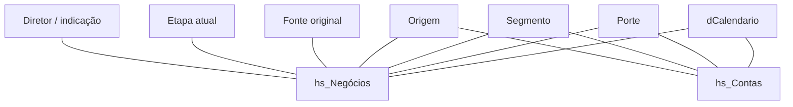
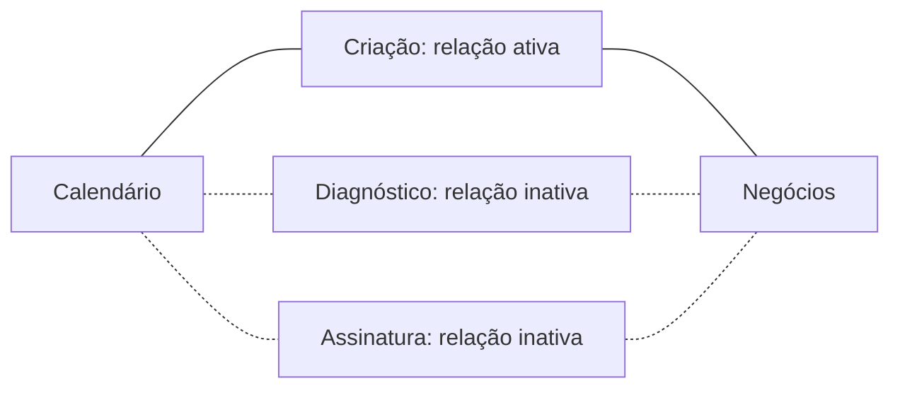

# Modelo de dados e comportamento dos filtros

## Estrutura observada

O modelo contém duas tabelas centrais para a narrativa do case:

- `hs_Negócios`: oportunidades e eventos do processo comercial.
- `hs_Contas`: dados obtidos de um objeto personalizado do HubSpot, com informações usadas em análises de contas e faturamento. Não deve ser confundida automaticamente com o objeto padrão companies.

As duas tabelas compartilham calendário e parte das dimensões. **Não foi encontrada relação direta entre hs_Negócios e hs_Contas no arquivo de relacionamentos.** Logo, não se deve inferir uma junção negócio-conta por identificador.

## Mapa resumido das relações ativas

As setas representam vínculos entre tabelas; a direção real de propagação do filtro está no inventário e não é codificada pelas setas deste desenho.

O relacionamento de diretor com contas existe, mas está inativo, por isso não aparece neste mapa de relações ativas.

## Calendário e datas de eventos

A data de criação é a relação ativa com o calendário em negócios e contas. Datas comerciais adicionais são relações inativas:

- Em negócios: agendamento, proposta, demo, assinatura, contrato enviado, diagnóstico, aceite, pagamento, faturamento e uma segunda data de demo.
- Em contas: conclusão de faturamento.

A medida de contratos assinados utiliza `USERELATIONSHIP` para calcular pela data de assinatura. Assim, o calendário pode ser usado na análise de etapas distintas sem tornar todas as relações ativas ao mesmo tempo.

Este esquema mostra vínculos, não a direção dos filtros. A interação exata entre relações, filtros e medidas depende do contexto DAX e precisa de validação no Power BI.

## Cardinalidade e propagação

O arquivo contém 24 relações: 11 ativas e 13 inativas. Dez declaram filtro bidirecional; esse total inclui relações inativas, que não propagam filtros por padrão.

Uma relação, entre origem dos negócios e a dimensão de origem, declara `toCardinality: many`, configurando muitos-para-muitos em conjunto com o lado de origem many padrão do formato. As demais omitem cardinalidades explícitas e utilizam os padrões do formato (many no lado de origem e one no destino).

Essas configurações foram lidas do arquivo; não comprovam unicidade dos dados, integridade das chaves ou ausência de caminhos ambíguos em execução.

Filtros bidirecionais podem propagar restrições nos dois sentidos quando a relação participa do cálculo. Com dimensões compartilhadas, isso pode afetar outras tabelas. Portanto, não se deve afirmar que todas as métricas de contas e negócios se cruzam automaticamente da forma desejada.

## Etapas e perdas

A etapa atual do negócio tem relação ativa com `filtro_etapas`. O vínculo de etapa da perda com essa mesma tabela está inativo. São dois papéis de análise distintos; usar a etapa da perda exige considerar a relação adequada na medida.

## Tabelas de apoio

Também foram encontradas definições de colaboradores, atividades, histórico de etapas, reuniões e pipeline/estágios. A existência de uma tabela não comprova um relacionamento direto com negócios. O [inventário](inventario-relacionamentos.md) lista somente os vínculos encontrados, sem inventar associações.
