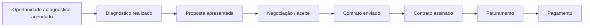

# Contexto e entregas

## Público e objetivo

O painel foi descrito como ferramenta de acompanhamento para o time de vendas e lideranças comercial e financeira. O objetivo é reunir evolução dos negócios, conversões, perdas e resultados financeiros.

## Fluxo de negócio

O diagrama resume o processo descrito. Não afirma que todo negócio percorreu todas as etapas nem que cada etapa equivale a uma tabela diferente.

## Entregas identificadas

- Visão conjunta de indicadores, evolução por período e valores.
- Funil comercial com volumes, valores, conversão e perdas.
- Páginas de detalhamento e acompanhamento dos negócios.
- Visões de tabela e Kanban.
- Parâmetros de campos para selecionar indicadores e granularidade temporal.
- Integração de negócios e de objeto personalizado do HubSpot.

Foram identificadas 14 definições de páginas, incluindo páginas de detalhe. A contagem não implica 14 telas principais de navegação.

## Transformação dos dados

Nas consultas foram observadas expansão de registros JSON, conversão de datas e números, classificação de porte, normalização de origem e tratamento de valores ausentes. As regras completas e os campos específicos da empresa não são distribuídos.

## Leitura dos resultados

Criação, diagnóstico, assinatura, faturamento e pagamento são eventos diferentes. O mesmo mês pode reunir eventos de negócios criados em outros períodos. Análises de fluxo por período e análises de coorte exigem regras distintas.

Os resultados financeiros visíveis nas imagens originais não são utilizados como indicadores públicos de desempenho do autor.
